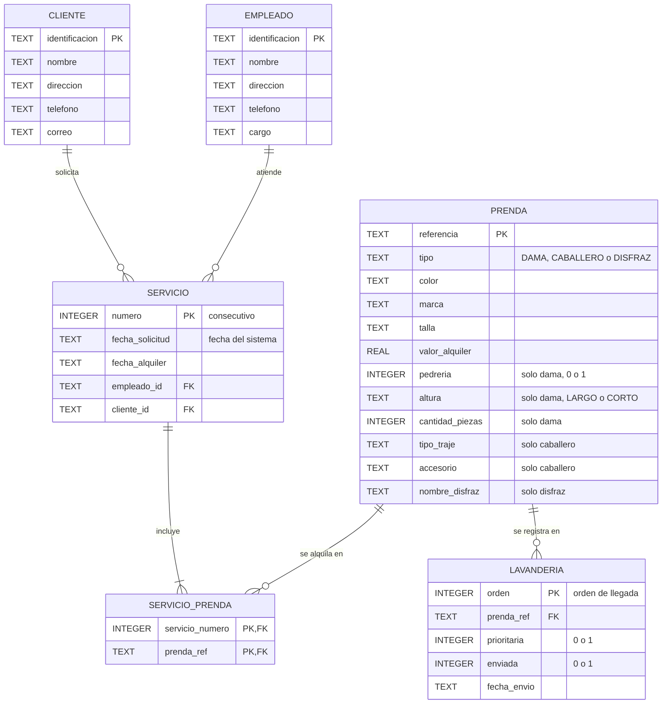

# Base de datos

Esquema relacional en SQLite, definido en [`esquema.sql`](esquema.sql). La aplicación lo ejecuta al conectarse, y crea `atuendos.db` si no existe.

## Diagrama



## Tablas

| Tabla | Contenido |
| --- | --- |
| `cliente` | Clientes, identificados por su `identificacion`. |
| `empleado` | Empleados, identificados por su `identificacion`. |
| `prenda` | Todas las prendas. La columna `tipo` indica el subtipo, y solo las columnas de ese subtipo tienen valor. |
| `servicio` | Servicios de alquiler, con número consecutivo, un cliente y un empleado. |
| `servicio_prenda` | Prendas de cada servicio. |
| `lavanderia` | Registros de envío a lavandería, pendientes o enviados. |

## Reglas

- **Subtipos de prenda:** una restricción `CHECK` exige las columnas propias de cada tipo y deja nulas las demás.
- **Consecutivo:** `servicio.numero` es entero autoincremental, y no se reutiliza.
- **Disponibilidad:** una prenda está disponible para una fecha si ningún servicio con esa `fecha_alquiler` la incluye.
- **Lavandería:** la lista pendiente son las filas con `enviada = 0`, ordenadas por `prioritaria` descendente y luego por `orden`. Un índice único evita que una prenda quede dos veces pendiente.
- **Claves foráneas:** SQLite las ignora si no se activan en cada conexión con `PRAGMA foreign_keys = ON`.

## Inspección

```bash
sqlite3 atuendos.db ".schema"
```
